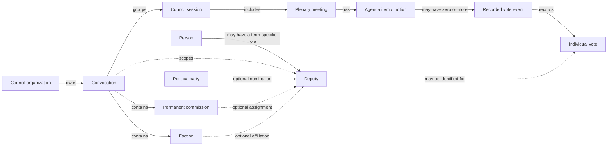
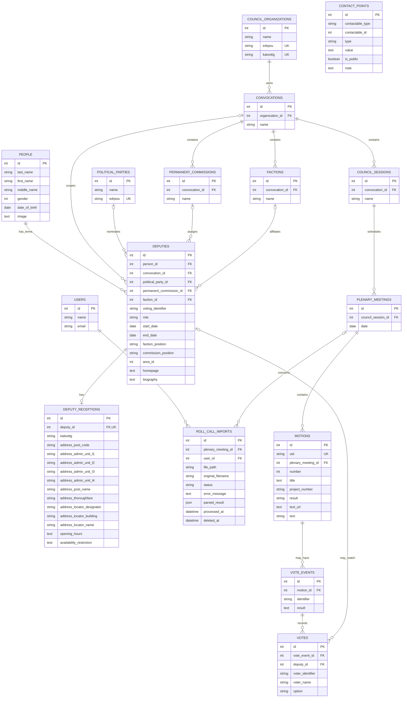

# Meetings, sessions, and deputy data architecture

## Scope

This page describes the current database relationships for council convocations, sessions, plenary meetings, deputies, and roll-call voting. It reflects the current table and column names after migrations; standard `created_at` and `updated_at` columns are omitted from the diagrams.

For the full roll-call import workflow and open-data mapping, see [Roll-call voting data architecture](./roll-call-voting.md) and [Open data](../open-data.md).

## Domain flow

A convocation belongs to one council organization. A council session is a named session within a convocation, not a dated meeting; each plenary meeting has its own date and belongs to one council session. Its organization is determined through that session's convocation. Each `deputies` row represents one person's deputy role in one convocation, so the same person can have several deputy records over successive convocations. Deputy term data is stored directly on that record; the council organization is derived through the convocation.

## Relational schema

`CONTACT_POINTS.contactable_type` and `contactable_id` form Laravel's polymorphic owner reference, not a conventional foreign key. Deputy contact points currently use this relation. `DEPUTIES.homepage` stores the deputy's page on the council website. Authentication columns beyond `users.id`, `name`, and `email` are not shown because users appear here only as roll-call import owners.

## Relationship and constraint notes

- `convocations` belong to a council organization; `(organization_id, name)` is unique, allowing different councils to use the same convocation label. The organization reference is nullable only to avoid inventing links for untouched pre-existing records; application-created convocations require an organization.
- `council_sessions` belong to a `convocations`; `(convocation_id, name)` is unique.
- `permanent_commissions` belong to a convocation and have a unique `(convocation_id, name)` pair. A deputy's commission is optional. The application validates that its commission belongs to the deputy's convocation; that cross-reference is not a database constraint.
- `factions` belong to a convocation and have a unique `(convocation_id, name)` pair. A deputy's faction is optional, and the application validates that it belongs to the same convocation.
- `deputies` hold one person's role for one convocation, including party, faction, commission, voting identifier, status, term dates, positions, electoral area, homepage, and deputy-specific biography. The council organization is derived from `convocation_id`, not copied. Database uniqueness constraints prevent duplicate `(person_id, convocation_id)` records and duplicate `(convocation_id, voting_identifier)` values.
- `deputies.convocation_id` is nullable only to preserve older deputy records that have no term membership; newly created deputy records require a convocation. The migration refuses to run if it finds a membership without a convocation, because dropping `organization_id` would otherwise lose the only organization link.
- When existing data is migrated, the first deputy term (ordered by the former membership ID) retains the original deputy record and its contact points and reception details; additional term records receive the same person, biography, and homepage, but no duplicated contacts or reception data.
- The faction extraction removes the former free-text `faction_name` values without migrating them into faction records.
- `people` stores a person's general identity and profile fields; a person can have multiple `deputies` records, at most one for each convocation. A person's full name is derived from the three name columns and is not stored as a separate `name` column. Deputy-specific `biography` remains on each term-specific deputy record, and each record can have at most one `deputy_receptions` row.
- A plenary meeting belongs to exactly one council session and inherits its organization through the session's convocation. A motion belongs to exactly one meeting; `(plenary_meeting_id, number)` and `uid` are unique.
- A motion may have no recorded vote or multiple `vote_events`. Each vote event belongs to one motion. A vote event can contain votes with or without a matched deputy: `votes.deputy_id` and `voter_identifier` are nullable, while `voter_name` and `option` preserve the imported voter details. `(vote_event_id, deputy_id)` is unique.
- A roll-call import always belongs to a user and may optionally reference a plenary meeting; its council session is reached through that meeting. It is independent of the motions created while reviewing its parsed results; imports use soft deletion.
- Core historical relationships use restrictive deletion rules to prevent deleting referenced deputies, organizations, sessions, meetings, motions, and vote events.

## Roll-call import boundary

Imports retain their uploaded file metadata, processing state, parsed JSON, and an optional meeting link; the session is derived through the meeting. The current PDF parser stores its output in `roll_call_imports.parsed_result`; it does not yet create normalized `motions`, `vote_events`, or `votes` records from that output. See [the import workflow](./roll-call-voting.md#pdf-import-parsing) for the review and processing details.
